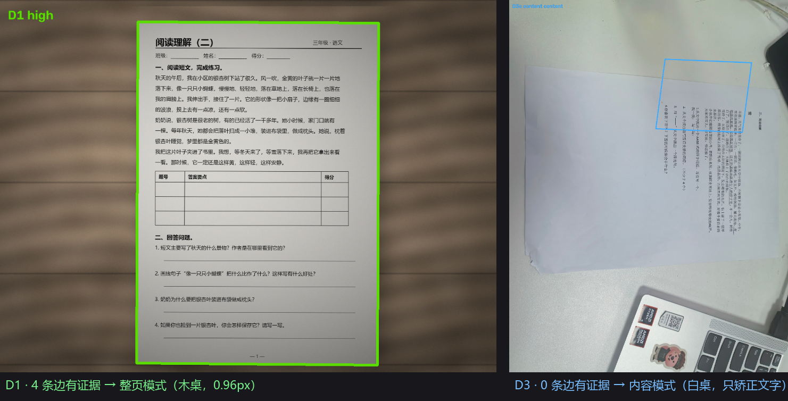

# 试卷自动拍摄（Scan & Auto-Capture）参考实现

复刻学习机扫描笔/扫描 App 的核心体验：**摄像头实时找到纸张四边 → 端稳后自动拍照 → 透视矫正成平整试卷**。

整个仓库是一个可跑的 Python 原型，包含**合成场景回放**（不需要真机/摄像头）与**实时摄像头模式**。

```bash
pip install -r requirements.txt
python run_sim.py          # 离线仿真：生成 out/demo.mp4 + 扫描结果 + 报告
python run_live.py --cam 0 # 用电脑摄像头实时体验（ESC 退出，空格强制拍照）
```

## 结果（`python run_sim.py` 实测）

| 指标 | 数值 |
|---|---|
| 首次触发时刻 | t=72 帧（≈2.4s），此前未误触发 |
| 自动拍摄取帧 | 环形缓冲中评分最高的 t=68 帧（不是当前帧） |
| 角点误差（全分辨率） | **0.41 px** |
| 角点误差（480p 分析流） | 0.93 px |
| 输出清晰度（Laplacian 方差） | 547 → **1707**（去阴影+锐化后） |
| 分析耗时 | 约 2.5–4 ms/帧（480×360，纯 CPU） |

`out/` 下产物：

- `demo.mp4` — 带 HUD 的完整过程（搜索 → 跟踪 → 锁定 → 倒计时 → 拍摄）
- `captured_scan.png` — 最终的扫描件（1240×1754，A4@150dpi）
- `score_timeline.png` — 综合评分曲线、阈值线、触发点
- `storyboard.png` — 三阶段拼图
- `report.json` — 逐帧评分与指标

## 流水线

```
相机帧 ──► 降采样 480×360 ──► 光照归一化 ──► Canny ──► 轮廓 ──► 四边形候选
                                                              │
                             ┌────────────────────────────────┘
                             ▼
                     角点亚像素精修（四边拟合直线求交）
                             ▼
                     跟踪：EMA 平滑 + IoU 门限 + 丢帧保持
                             ▼
                     综合评分 0~1：支撑率/面积/抖动/IMU/清晰度/几何/反光
                             ▼
              ≥0.74 且连续 6 帧 且 ω≤2.2°/s ──► 计数 18 帧 ──► 触发
                             ▼
              环形缓冲挑最优帧 ──► 全分辨率 cornerSubPix ──► 透视变换 ──► 增强
```

各模块对应关系：

| 文件 | 职责 |
|---|---|
| `scanner/page.py` | 合成一张密排中文试卷（含表格、答题横线），即检测的最难场景 |
| `scanner/scene.py` | 木桌背景 + 手持运动模型（逼近、抖动、稳定）+ 伪 IMU 角速度、反光、运动模糊 |
| `scanner/pipeline.py` | 检测 / 精修 / 跟踪 / 评分 / 状态机 |
| `scanner/capture.py` | 全分辨率重定位、透视矫正、去阴影增强 |
| `scanner/viz.py` | HUD 叠加（中文用 PIL 渲染） |

## 调参

`scanner/pipeline.py:Config` 里集中了所有门限：

| 参数 | 默认 | 说明 |
|---|---|---|
| `score_on` | 0.74 | 综合评分阈值，调低更灵敏但误触发变多 |
| `stable_frames` | 6 | 连续多少帧过线才进入倒计时（0.2s） |
| `countdown_frames` | 18 | 倒计时长度（0.6s），期间逐帧复核，掉线即中止 |
| `imu_gate` | 2.2 | 陀螺角速度上限（°/s） |
| `ema_alpha_slow/fast` | 0.30 / 0.55 | 静止/运动时的平滑系数 |
| `iou_gate` | 0.45 | 相邻帧四边形重叠度，低于此判定为跳变/丢失 |
| `min_area_ratio` | 0.16 | 纸张最小面积占比 |
| `low_contrast` | False | 白桌白纸模式：合并宽松 Canny(8,24) 边缘图 |
| `escalate_after` | 2 | D1 连续多少帧无候选后启用 D2 |
| `escalate_text_after` | 4 | 再多少帧后启用 D3（文本块） |
| `text_every` | 4 | D3 的最小间隔帧数（太贵，不能每帧跑） |
| `text_width` | 1600 | D3 的输入宽度上限；低于 ~1200 字形掩膜会碎裂，实测 1280/1440 会把文本块认错 |

评分权重（`pipeline.py` 中 `raw_score`）：

```
0.26·边缘支撑率 + 0.18·面积 + 0.22·稳定度 + 0.10·IMU
+ 0.16·清晰度 + 0.08·几何规整度 − 0.35·反光惩罚
```

## 精度：ROI 跟踪 + 全分辨率直线精修

分析流 480p 出的角点，直接放大到原图会带 3px 左右的误差（DocAligner 把这个叫 *amplification error*）。所以 `Tracker` 拆成两段：

1. **ROI 跟踪**（每帧）：以上一帧四边形外扩 22% 作为搜索窗，裁剪后缩放到固定像素预算再检测——页面只占画面 40% 时，等效分辨率提高到 1.6 倍，代价不变。
2. **全分辨率直线精修**（触发时）：`refine_quad_lines()` 在原始分辨率上，沿每条边的法线 ±6px 搜梯度脊线（抛物线插值到亚像素），每边拟合一条直线（两轮残差剔除），相邻求交。

实测（`run_sim.py`）：

| 项 | 数值 |
|---|---|
| 粗角点误差（全分辨率） | 3.04 px |
| 精修后 | **0.41 px** |
| 精修耗时 | 16 ms（纯 Python） |
| 单帧耗时（稳定段） | 9.9 ms（木桌）/ 23.4 ms（白桌，会升级到 D2/D3） |

顺带修掉一个性能坑：`GaussianBlur(sigma=25)` 在 480p 上要 20ms/次，改成“缩小 → 小核模糊 → 放大”的金字塔近似后，整条链路从 50ms/帧降到 22ms/帧。

## 低对比度：白桌 + 白纸

`experiments/` 下有三个探针，用同一段手持序列、同一张试卷，只改桌面颜色/阴影：

```bash
python experiments/edge_probe.py        # 单帧：各边缘检测器在不同桌面上的表现
python experiments/low_contrast_probe.py # 边界灰阶差 vs 可定位性
python experiments/low_contrast_run.py   # 端到端：基线 vs low_contrast 模式
```

端到端结果（95 帧，`trigger=never` 表示整段都没拍到）：

| 桌面 / 阴影 | 边框灰阶差 | 基线 | `low_contrast=True` |
|---|---|---|---|
| 木桌 | ≈76 | t=72，0.96 px | t=73，1.83 px |
| 白桌 + 接触阴影 | ≈21 | **never（0% 检出）** | t=94，1.20 px |
| 白桌 + 弱阴影 | ≈8.5 | never | never（0% 检出） |
| 白桌 + 无阴影 | ≈4.5 | never | never |

结论：

1. **基线（Canny 35/105 + 轮廓）的失效点大约在 Δ≈25 灰阶**。白桌有阴影时纸边只剩 ~21 灰阶，Canny 一个像素都不出。
2. 降阈值到 `Canny(8,24)` 能"看见"纸边（覆盖率 100%），但**边缘不闭合**：Δ=21 时最大闭合轮廓是纸张（77k px²），Δ=8.5 时最大轮廓只有 10k px²（一个文字块）。轮廓法在这种对比度下是结构性失效，不是调参能解决的。
3. 低对比下角点抖动变大，原来的"速度自适应 EMA"会把它误判成运动而加速跟踪，形成抖动正反馈。已改为 **IMU 门控 + 用平滑后位移计速**（见 `Tracker.step`），否则白桌场景永远攒不到触发分。
4. 真正稳的解法依次是：**引导阴影/垫深色纸** → **线段检测（LSD/EDLines）+ 直线拟合求交**（对 Δ≈5–10 的长直线仍有效，实测 LSD 在 Δ=21 时覆盖 99%、Δ=8.5 时 46%）→ **分割/角点模型**（白桌白纸必须作为难例进训练集）→ **手动拖角兜底**。

`Config(low_contrast=True)` 就是上面第 2 条的工程化版本：合并一张宽松边缘图，再用更严的几何约束（边长、面积、不贴画框、边缘支撑）挡掉噪声。

## 分级检测：D1 → D2 → D3

`Tracker` 现在按证据自己选检测器和几何目标：

| 层 | 方法 | 何时启用 | 输出 |
|---|---|---|---|
| D1 | Canny(35,105) + 轮廓 | 每帧 | 整页 |
| D2 | Canny(8,24) + 严格几何 | D1 连续 2 帧无候选 | 整页 |
| D3 | 文本块（`textprior`） | D1+D2 连续 4 帧无候选，每 4 帧最多跑一次 | 内容 |

**模式由证据边数决定**，不是拍脑袋的阈值：在 σ=9 的模糊梯度上逐边测支撑——文字是高频，模糊后消失，不会伪造出"纸边"。

| 证据边数 | 模式 | 置信度 | 行为 |
|---|---|---|---|
| 4 / 3 | page | high | 自动拍，出整页 |
| 2 | page | medium | 自动拍，出整页 |
| ≤1 | content | content | 只矫正文字区域 |

同一段 95 帧手持序列，三种配置对比（`experiments/low_contrast_run.py`）：

| 场景 | D1 | D2 | 分级系统 |
|---|---|---|---|
| 木桌 | t=72，0.96px | t=73，1.83px | t=72，0.96px，page |
| 白桌+阴影（Δ21） | 0% | t=94，1.20px | **t=72，0.86px，page** |
| 白桌弱阴影（Δ8.5） | 0% | 0% | **t=73，content** |
| 白桌无阴影（Δ4.5） | 0% | 0% | content 可用，触发约 t=95 |

真实照片（`data/real_white_desk.jpg`）：D1/D2 均 0 候选，第 4 帧 D3 接管，输出内容框；此后每 4 帧刷新一次，中间帧复用（`D3c`），并用面积跳变门限挡掉字形掩膜的抖动。



D3 在 1280 宽输入上约 400ms（纯 Python），所以按 4 帧一次调度并用缓存兜住中间帧；设备端同样逻辑在几十毫秒量级。

## 文本块先验：纸边看不见时的兜底

```bash
python run_text_prior.py --flip        # 输出 out/textprior/content.png
```

`scanner/textprior.py` 换了个锚点：不去找 0–5 灰阶的纸边，去找 150 灰阶的文字。

1. **字形筛选**：光照归一化后 Otsu 二值化，按面积/长宽比/相对高度过滤连通域——键盘键帽、贴纸、桌面纹理被滤掉，只留印刷字。
2. **文本块**：膨胀合并 → 最大连通块 → 该块内的字形像素。
3. **方向**：行投影周期性定 90° 家族；段落首行缩进消除 180° 歧义（缩进检测在这张图上不够稳，演示用 `--flip` 指定，产品里用 OCR 首行置信度判定，零成本）。
4. **内容矫正**：把文本块转正、去光照梯度、锐化输出，OCR 可直接用。

实测（`data/real_white_desk.jpg`，白纸白桌）：

| 项 | 结果 |
|---|---|
| 纸边检测（基线 / 低对比 / Otsu） | 全部 0 候选；Otsu 把桌面和纸连成一片 |
| 文字块检测 | 稳定，bbox 正好压在正文上 |
| 文本块周围暗缝响应 | 0.02（页面边缘在画面里几乎无信号）|
| 可见白色区域宽高比 | 1.16（A4 = 1.414），右侧无任何暗缝 |
| 内容矫正 | 成功，正立可读 |

**结论**：这张图里纸张没有完整入画（右侧出框 / 被笔记本遮挡），"文本框 + A4 比例"的前提不成立，整页四角不可恢复。但**对语文阅读理解批改这个业务，根本不需要整页四角**——需要的是把文字区域转正喂给 OCR。所以最优路径是"内容级矫正"，整页扫描件只是展示需求，需要用户把纸拍全或给深色背景。

## 从原型到真机

- **采集**：Android CameraX `ImageAnalysis`（YUV_420_888，只取 Y 平面，零拷贝）+ 独立的高分辨率 Still Capture；分析 15fps、预览 30fps。
- **IMU**：`Sensor.TYPE_GYROSCOPE` 与帧时间戳对齐，静止判定比纯视觉更早、更省电。
- **性能**：480p 全流程 ~2.5ms/帧（本机 CPU），中端 ARM 约 8–12ms；若要更强鲁棒性，把 `detect()` 换成 256×256 的角点热力图小模型（NPU 5–10ms），角点精修逻辑不变。
- **合成数据**：`scene.py` 的运动/光照/反光模型可直接扩成训练数据生成器（随机透视、桌面纹理、遮挡、弯折）。
- **弯曲纸张**：本原型只做单应矫正；书脊/卷角需要额外 dewarp（柱面模型或 TPS）。
- **拍后质检**：真实产品还要在拍照后再算一次模糊/曝光/反光，不合格直接提示重拍，别把问题留给 OCR。


## 仓库内容说明

- **入库**：Python 参考实现、实验脚本、Android 工程全部源码，以及
  `android/app/src/main/assets/docaligner_fastvit_t8.onnx`（13 MB，编译必需，缺了 Android 工程起不来）。
- **不入库**（见 `.gitignore`）：
  - `models/`：DocAligner 权重下载与解包目录，可用 `experiments/docaligner_test.py` 重新下载（地址见 `android/README.md`）。
  - `data/`：测试照片，换任意白底白纸照片都能复现对比实验。
  - `out/`：运行产物（`demo.mp4`、逐帧截图、扫描件），跑一遍 `run_sim.py` 即可重新生成。
  - `android/app/build/`、`.gradle/`、`local.properties`、`*.apk`。

## 已知局限

- 场景是合成的，阴影/反光是程序化生成，真实反光的饱和形态更复杂。
- 未接入真实 IMU（用运动模型推导的伪角速度代替）。
- 只做矩形单应，不处理纸张弯曲；不含 OCR 环节。
