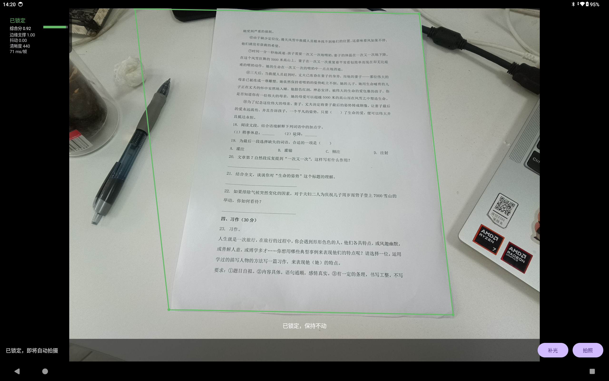

# PaperScan — 试卷边缘检测 + 自动拍照 + 透视矫正（Android）

Kotlin + CameraX + OpenCV 的端侧实现，算法是仓库根目录 Python 原型的直接移植。

```
预览 → 每帧检测纸张四边形 → 时序跟踪/平滑 → 评分 → 倒计时 → 自动拍照
     → 全分辨率直线精修 → 透视变换 → 去阴影 → 保存 JPEG
```

## 构建 / 安装

```bash
cd android
gradle :app:assembleDebug
adb install -r -g app/build/outputs/apk/debug/app-debug.apk
```

产物：`android/app/build/outputs/apk/debug/app-debug.apk`（约 140 MB，主要是 OpenCV 原生库）。

扫描件保存到 `Android/data/com.dsh.scanner/files/scans/`。

## 代码结构

| 文件 | 职责 |
|---|---|
| `MainActivity.kt` | CameraX 绑定、拍照流程、UI 状态机回调 |
| `ScanAnalyzer.kt` | `ImageAnalysis.Analyzer`：YUV→灰度、检测、跟踪（后台线程） |
| `DocDetector.kt` | 光照归一化 → Canny → 轮廓 → 四点凸四边形 → 边缘支撑评分 → 亚像素直线精修 |
| `DocTracker.kt` | EMA 平滑、评分（支撑/面积/稳定度/IMU/清晰度/规整度）、倒计时状态机 |
| `ScanCapture.kt` | 全分辨率精修 → 透视变换到 A4(1240×1754) → 去阴影 + 锐化 → JPEG |
| `OverlayView.kt` | 四边形、角点、评分条、倒计时环、状态文案 |
| `MotionGate.kt` | 陀螺仪角速度（用于"手持是否稳定"判定） |
| `ImageOps.kt` | YUV→Mat、金字塔背景、Laplacian 方差、Bitmap 互转 |

## 关键参数

`DocTracker` 构造参数：

| 参数 | 默认 | 说明 |
|---|---|---|
| `scoreOn` | 0.72 | 综合分阈值 |
| `stableFrames` | 5 | 连续过线帧数才进入倒计时 |
| `countdownMs` | 700 | 倒计时时长，期间掉线即中止 |
| `cooldownMs` | 1500 | 拍完冷却，避免连拍 |
| `imuGate` | 25 | 陀螺角速度上限（°/s） |

`DocDetector` 构造参数：`lowContrast`（合并宽松 Canny，白桌白纸用）、`minAreaRatio`、`minSupport`。

## 真机验证（本机实测）

设备：MediaTek W888（Android），USB 调试。

| 项 | 结果 |
|---|---|
| 编译 | ✅ `BUILD SUCCESSFUL` |
| 安装运行 | ✅ 无崩溃，相机绑定正常 |
| 实时性能 | **7 ms/帧**（640×480 检测，含跟踪与评分） |
| 自检（内置测试图） | ✅ 支撑率 1.00、面积 0.446，矫正输出正确 |
| 横屏输出 | ✅ analysis 640×480、still 3264×2448、矫正件 1754×1240（横版） |
| 自动触发 | ✅ 虚拟相机模式：评分 0.99 → 倒计时 → 自动拍摄 → 保存 |
| CameraX 拍照链路 | ✅ 真机拍照 → 解码 → 精修 → 透视 → 保存 |

## 调试入口（Intent extra）

```bash
# 用内置图片跑一遍 检测→精修→透视→保存
adb shell am start -n com.dsh.scanner/.MainActivity --ez selftest true

# 虚拟相机：把内置图片当视频流喂进实时循环，验证自动触发
adb shell am start -n com.dsh.scanner/.MainActivity --ez virtual true

# 不依赖检测，用中心 80% 的框走一遍真实 CameraX 拍照链路
adb shell am start -n com.dsh.scanner/.MainActivity --ez forcecapture true
```


## 角点模型（低对比度兜底）

白纸压在白桌上时经典检测器返回 0 个候选（实测 `contours=150 fourPoint=0`），此时自动降级到
[DocAligner](https://github.com/DocsaidLab/DocAligner) 的 **fastvit_t8** 角点模型：

| 项 | 值 |
|---|---|
| 模型 | DocAligner fastvit_t8（ONNX，Apache-2.0） |
| 体积 | 13.2 MB（`assets/docaligner_fastvit_t8.onnx`） |
| 输入 | 256×256 BGR，/255，**无 mean/std 归一化** |
| 输出 | 4×128×128 角点热力图 |
| 解码 | 峰值 + 加权质心 → 映射回原图 |
| 运行库 | onnxruntime-android 1.20（CPU EP） |

### 集成要点

1. **ROI 放大**：有上一帧框时，按框外扩 25% 裁剪成正方形再送入模型，让页面填满 256 输入——置信度从 0.3 提到 0.8+。
2. **3 点补全**：模型偶尔只给出 3 个角点，用平行四边形约束 `p_i = p_{i+1} + p_{i+3} - p_{i+2}` 补第 4 点，再交给全分辨率直线精修。
3. **缓存复用**：模型 150ms，每 3 帧跑一次，中间帧复用上次结果（`model-cached`），保证框稳定。
4. **降级顺序**：`edge`（3–8ms）→ `model`（150ms）→ 无。

### 实测（MediaTek W888）

| 场景 | 经典 CV | + 模型 |
|---|---|---|
| 白桌白纸 | 0 候选 | **锁定，评分 0.91，自动拍摄成功** |
| 木桌 | 锁定 | 不变（走 edge，不跑模型） |



模型推理 150–160ms；APK 从 141MB 降到 **58MB**（`abiFilters` 只保留 arm64-v8a）。


### 性能：release 构建是关键

同一个模型、同一台设备，debug 和 release 差了 4 倍——开销不在推理，在 debug 构建的 Kotlin/JIT：

| 指标 | debug | release |
|---|---|---|
| 单次模型调用 | 583–632 ms | **151–178 ms** |
| 其中 ORT 推理 | 145 ms | 145 ms |
| 每帧平均 | 199–303 ms（~4 fps） | **52–75 ms（~19 fps）** |
| 角点 | 2–4/4，抖动大 | **4/4 稳定，0.83–0.90** |

所以性能测试一律用 release 构建，debug 的数字没有参考价值。

### int8 量化：试过，否决了

| 方案 | 体积 | x86 推理 | 设备推理 | 精度（白纸场景峰值） |
|---|---|---|---|---|
| fp32 | 13.2 MB | 11.2 ms | 145 ms | 0.83–0.90 ✅ |
| 动态 int8 | 3.6 MB | 222 ms ❌ | — | 0.00 ❌ |
| 静态 QDQ int8 | 3.9 MB | 39 ms ❌ | 130 ms | 0.03–0.18 ❌ |

- 动态量化对卷积网络会插入低效的 DynamicQuantizeLinear，慢 20 倍且输出归零。
- 静态 QDQ 体积降到 30%，但精度崩了：低对比度场景本来余量就小，量化误差直接吃掉了。
- 唯一收益是体积（-9 MB），速度几乎没变（145→130 ms）。

结论：这个模型和场景不适合 int8。要提速应该换更小的模型或降低调用频率，而不是量化。

### 已知问题

- **NNAPI 反而更慢**（628ms vs 147ms），已改回 CPU EP。
- 角点偶发只有 2–3 个（另一角置信度 ~0.05），靠补全 + 精修兜住，但框会轻微外扩。
- 帧率约 19 fps（release 构建，模型每 3 帧一次），适合“端稳后自动拍”的节奏，不适合高速连拍。
- 下一步：换更小的模型或降低模型调用频率；int8 已验证不可行（见上）。

## 已知限制

- **低对比度场景**：白纸压在白色桌面/白色笔记本上时，边界只有 0–5 个灰阶，检测器返回空（与 Python 原型一致）。产品上应引导用户换深色背景，或开启 `lowContrast`。
- **OpenCV 依赖**：使用 Maven 的 `org.opencv:opencv:4.9.0`，首次构建需联网下载。
- **横屏**：Activity 锁定横屏（`sensorLandscape`），预览用 `fitCenter` 显示完整 4:3 画面（左右留黑边），HUD 用同样的缩放置信映射。
- **输出比例**：矫正后的尺寸跟随纸张朝向——横版试卷输出 1754×1240，竖版输出 1240×1754，不会被拉伸。
- **性能**：7ms 是 640×480 的结果；若换 720p 分析流，需同步调整 `ResolutionSelector` 并复测。

## 与 Python 原型的对应关系

| Python | Kotlin |
|---|---|
| `pipeline.detect()` | `DocDetector.detect()` |
| `pipeline.refine_quad_lines()` | `DocDetector.refine()` |
| `pipeline.Tracker.step()` | `DocTracker.update()` |
| `capture.capture_scan()` | `ScanCapture.process()` |
| `viz.draw_hud()` | `OverlayView` |
